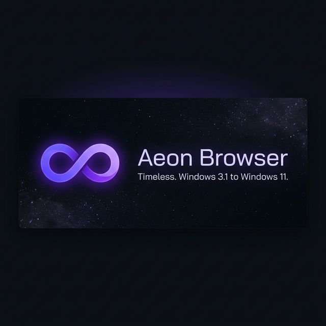
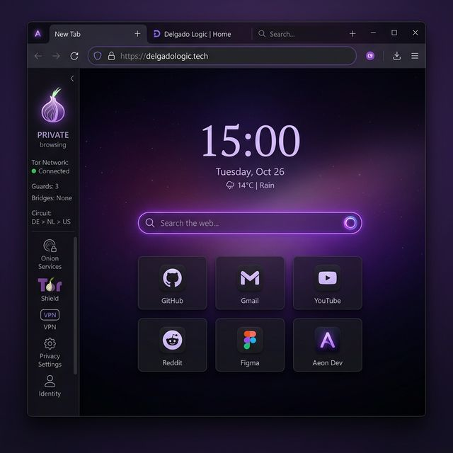
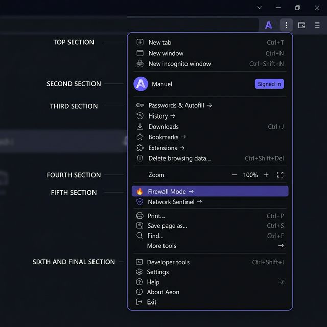
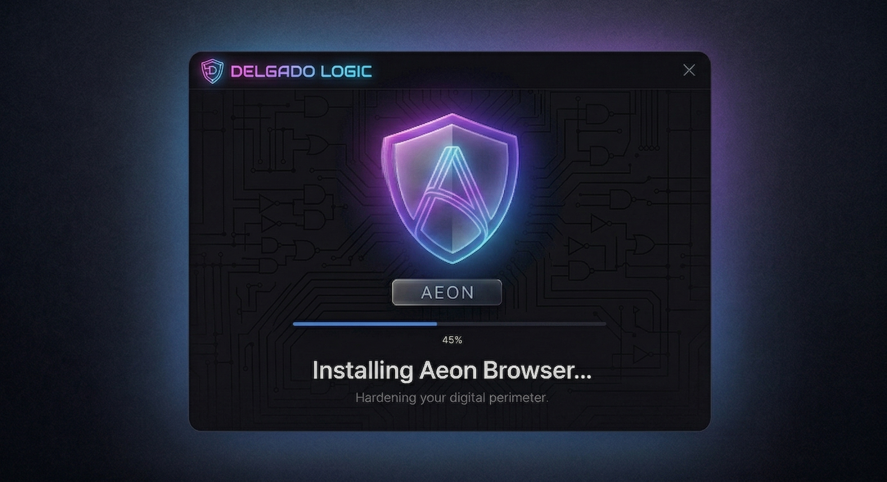

<div align="center">



<br/>


# Aeon Browser

**The sovereign browser. Opt-in telemetry (OFF by default). Built for privacy and control.**

*Built from scratch by [DelgadoLogic](https://github.com/DelgadoLogic) · Windows 10 / 11 (x64)*

<br/>

[](https://github.com/DelgadoLogic/aeon-engine/releases)
[](https://github.com/DelgadoLogic/aeon-engine)
[](https://github.com/DelgadoLogic/aeon-engine)
[](LICENSE)
[](resources/pages/intelligence.html)

</div>

---

## What Is Aeon?

Aeon is a **ground-up sovereign browser** engineered from first principles with one objective: **you own your browsing, completely**.

No Google DNS resolvers phoning home. No Safe Browsing cloud calls. No sync servers we don't control. Telemetry (`OmniPulse`) is strictly opt-in (`ConsentLevel.None`, OFF by default on Free & Pro tiers) with zero IP persistence on disk. Built natively for Windows 10/11 (`win-x64`) with tiered legacy hardware compatibility.

---

## Screenshots

<div align="center">



*New Tab Page · Deep space obsidian dark mode · Glassmorphism speed dial · Private search*

<br/><br/>



*App Menu · Firewall Mode · Network Sentinel · Opt-in pseudonymous telemetry (OFF by default — ConsentLevel.None)*

<br/><br/>



*Installer · Ed25519-signed sovereign manifest · "Hardening your digital perimeter"*

</div>

---

## Core Philosophy — AeonDNA

| Principle | What It Means |
|-----------|--------------|
| 🛡 **Sovereignty** | No Google, Microsoft, or third-party cloud calls by default. Ever. |
| 🌍 **Universality** | 8 hardware tiers covering every Windows version ever shipped |
| 🤖 **Autonomy** | 6-agent Evolution Engine patches CVEs while you sleep |
| 🔐 **Privacy by Architecture** | Zero-knowledge sync · Local AI only · P2P collective intelligence |
| 🔗 **Zero CVE Inheritance** | Built from scratch — no upstream vulnerability debt |

---

## Key Features

### 🌐 Runs On Everything — 8-Tier Engine System

Aeon auto-detects your hardware at launch and loads the right engine automatically.

| Tier | Platform | Renderer | TLS |
|------|----------|----------|-----|
| **Pro** | Windows 10 / 11 | Stripped Blink (no Google DNA) | TLS 1.3 native |
| **Modern** | Windows 8 / 8.1 | Stripped Blink | TLS 1.3 native |
| **Extended** | Windows Vista / 7 | Gecko (light build) | Schannel unlocked |
| **XP-Hi** | Windows XP (SSE2) | Blink XP build | BearSSL |
| **XP-Lo** | Windows XP (no SSE2) | Gecko no-SSE2 | BearSSL |
| **Win2000** | Windows 2000 | HTML4 GDI engine | BearSSL |
| **Win9x** | Windows 95 / 98 / ME | HTML4 GDI 32-bit | BearSSL 32-bit |

---

### 🔒 Privacy & Circumvention Stack

```
All traffic → Rust Protocol Router (aeon_router.dll)
├── 14 schemes: https, tor://, i2p://, gemini://, ipfs://, magnet:, aeon://...
├── DNS: DoH cascade — Cloudflare ECH → Quad9 → NextDNS + CNAME Uncloaking
└── CircumventionEngine:
    ├── ByeDPI / GoodbyeDPI — SNI fragmentation, evades deep packet inspection
    ├── zapret              — TCP window manipulation
    ├── ECH                 — hides destination domain from ISP/DPI
    ├── Kyber-768 TLS 1.3   — Post-quantum quantum-resistant key exchange
    └── Tor meek            — last resort bridge if all else is blocked
```

- **Network Sentinel & CNAME Uncloaking** — real-time DNS uncloaking and domain firewall rule enforcement
- **Camoufox C++ Stealth Engine** — Canvas 2D, WebGL, and AudioContext entropy randomization
- **Firewall Mode** — whitelist-only; nothing gets through unless you explicitly allow it
- **Built-in Ad Blocker** — updated via sovereign P2P, no cloud dependency

---

### 🎨 Obsidian Design System & Power Navigation

- **Obsidian 36px Chrome & Vertical Tab Sidebar**: Ultra-compact 36px top chrome with optional 240px vertical sidebar for reading immersion.
- **AeonOmni Auto-Suggest HUD**: Floating dark obsidian prediction HUD featuring multi-provider search suggestions (DuckDuckGo, Google, Brave, Bing, SearXNG), SQLite history/bookmark fuzzy matching, and inline recursive-descent math/unit evaluation.
- **Visual Tab Groups & Split View**: Color-coded group headers and side-by-side dual-webview rendering inside the content area.
- **Tab Memory Saver**: Automatic background tab suspension (`put_IsSuspended(TRUE)`) for idle tabs (>30m).
- **10 Unified Obsidian Pages**: `aeon://newtab`, `aeon://settings`, `aeon://shields`, `aeon://extensions`, `aeon://history`, `aeon://bookmarks`, `aeon://passwords`, `aeon://downloads`, `aeon://intelligence`, `aeon://diagnostics` (plus `aeon://drm-info` and `aeon://crash`).

---

### 🧠 On-Device AI & `window.ai` Standard Web API

Aeon features full on-device AI inference with zero cloud dependency:

- **Local Inference Engine (`aeon_ai.dll`)**: Embedded in-process GGUF runner (Gemma 4 E4B Q4_K_M) + fast TF-IDF extractive summarizer.
- **Multi-Model Intelligence Hub (`aeon://intelligence`)**: Hybrid local inference with optional multi-provider cloud router (Gemini, Claude, OpenAI, DeepSeek, Groq, Ollama) and collapsible reasoning trace visualization.
- **Standard `window.ai` API Polyfill**: Standard WICG Prompt API (`createTextSession()`, `prompt()`) injected into web contexts, routing directly to local AI.
- **Native Agent Automation (`\\.\pipe\aeon-agent`)**: Named pipe IPC server supporting 16 JSON-RPC commands and 40 MCP tools for DOM extraction, navigation, and Playwright `auth.json` session export/import.

---

### 🤖 Autonomous Evolution Engine — The Browser That Patches Itself

While you browse, six AI agents run silently in the background:

| Agent | Role |
|-------|------|
| **Research Agent** | Monitors NVD, GitHub Advisories, arXiv, CISA KEV 24/7 for new CVEs |
| **Patch Writer** | CodeLlama generates C++ fixes for vulnerabilities targeting our codebase |
| **Vote Coordinator** | 66% of AeonHive peers must approve a patch before it applies |
| **Build Worker** | Donates idle CPU to the P2P Ninja build mesh — gets faster with more users |
| **Self Trainer** | Weekly LoRA fine-tune on GCP — AI improves its own patch quality every Sunday |
| **Silence Policy** | Pauses ALL background tasks when CPU > 15% or you're actively using your machine |

---

### 🧩 AeonHive — The P2P Network That Gets Faster With Users

Every Aeon installation is a node. The more people use Aeon, the more powerful it gets for everyone:

```
100 users    → anchor nodes carry all load            → builds ~normal speed
1,000 users  → 100 donate idle CPU                    → builds 3× faster
10,000 users → 500 donate idle CPU                    → builds 15× faster
100,000 users→ network self-sustaining                → infrastructure cost → $0
```

---

### 🔄 Sovereign Updates — Ed25519 Signed, Always Verified

No update is ever blindly trusted. Every release is:

1. **Built** in our isolated GCP Cloud Build environment
2. **Signed** with our Ed25519 master key (stored in GCP Secret Manager — never on disk)
3. **Distributed** P2P via AeonHive (BitTorrent-style — cheap, fast, resilient)
4. **Verified** by your installed Aeon — SHA-256 + Ed25519 before anything runs

---

## Platform Roadmap

```
✅ Phase 1 — Windows (v0.22.0)       Production Baseline: 5 Binaries, Obsidian UI, AeonOmni, Tab Groups, window.ai
🟡 Phase 2 — Security & Release (Q3 2026)  Inno Setup Installer, Authenticode OV Signing, Offline Licensing
🟢 Phase 3 — Launch & Revenue  (Q4 2026)  Public Release at aeon.delgadologic.tech, Search Syndication, Pro & Teams Subscriptions
🔵 Phase 4 — Legacy Liberation (Q1 2027)  Gecko 115 ESR (Win7/8) + GDI HTML4 BearSSL (XP/Vista) — 73M Desktops
🟣 Phase 5 — AeonHive P2P Mesh (Q2 2027)  iroh QUIC Transport, DHT DNS Sharing, GossipSub Configs, P2P Blobs
⚪ Phase 6 — Multi-Platform    (Q3 2027)  Linux GTK4 Shell, Android Privacy Shell, macOS Cocoa, iOS
🧠 Phase 7 — AeonMind AI Mesh  (2028+)    Distributed LLM Training & Federated Fine-Tuning across Aeon Swarm
```

---

## Repository Structure

```
DelgadoLogic/aeon-engine/
├── AeonMain.cpp                  # Main Win32 application entry point & WndProc
├── CMakeLists.txt                # Unified CMake build configuration
├── build.ps1                     # Automated one-command build orchestrator
├── core/                         # Core browser subsystems (C++17/20)
│   ├── ui/                       # BrowserChrome, OmniSuggestHUD, TabGroupManager, SplitViewController
│   ├── engine/                   # TierDispatcher, AeonBridge, ABI interfaces
│   ├── settings/                 # SettingsEngine (JSON configuration persistence)
│   ├── history/                  # HistoryEngine (SQLite visits & bookmarks)
│   ├── security/                 # PasswordVault (DPAPI AES-256 credential storage)
│   ├── download/                 # DownloadManager (multi-threaded download queue)
│   ├── memory/                   # TabSleepManager (tab memory discard controller)
│   ├── network/                  # NetworkSentinel, DnsResolver (CNAME uncloaking)
│   ├── agent/                    # AeonAgentPipe (Named Pipe IPC \\.\pipe\aeon-agent)
│   ├── session/                  # SessionManager (30s autosave & crash recovery)
│   ├── billing/                  # OmniLicense (hardware probe HWID binding)
│   ├── probe/                    # HardwareProbe (CPU/RAM/OS tier detection)
│   └── tls/                      # TlsAbstraction (BearSSL / SChannel TLS 1.3)
├── engines/                      # Rendering engine adapters & dynamic libraries
│   ├── blink/                    # Chromium WebView2 adapter (aeon_blink.dll)
│   ├── gecko_stealth/            # Camoufox C++ anti-fingerprinting engine (aeon_gecko_stealth.dll)
│   └── aeon_ai.cpp               # Local AI inference engine & summarizer (aeon_ai.dll)
├── router/                       # High-performance Rust protocol router (aeon_router.dll)
├── agent/                        # TypeScript WebMCP agent tooling (agent/aeon-mcp/)
├── ai/                           # AI models, TabIntelligence, JourneyAnalytics
├── installer/                    # Inno Setup installer scripts (AeonProSetup.iss)
├── resources/                    # UI resources, Obsidian internal pages, and icons
│   ├── pages/                    # settings, shields, extensions, history, bookmarks, passwords, downloads, intelligence, diagnostics, drm-info, crash
│   ├── newtab/                   # newtab.html (Obsidian dark dashboard)
│   └── icons/                    # Multi-resolution Aeon.ico assets
├── internal_docs/                # 39 internal architecture, roadmap & audit documents
└── tests/                        # Unit, stress, adversarial, and 6-tier E2E test suites
```

---

## Building Aeon

### Prerequisites
- Windows 10/11 (x64)
- Visual Studio 2022 Build Tools (MSVC `cl.exe`, `rc.exe`)
- CMake 3.20+
- Rust 1.75+ (`cargo`)
- Inno Setup 6 (for packaging)

### One-Command Build Pipeline
```powershell
# Build all 5 release binaries and package publish/Pro/
.\build.ps1 -Tier Pro -Config Release

# Build release installer (dist/AeonBrowser_Setup_v0.22.0.exe)
.\installer\build_installer.ps1
```

### Running Test Suites
```powershell
# Run 6-tier master E2E test suite (314 tests)
node tests/e2e/run_all_e2e.mjs

# Run native C++ RSA-2048 & Ed25519 crypto suite
powershell -NoProfile -ExecutionPolicy Bypass -File tests\run_test_omni_license.ps1
```

---

## Security

**Found a vulnerability?** Do not open a public issue.

📧 `security@delgadologic.tech`  
🔑 PGP key: `delgadologic.tech/pgp`

We triage all reports within **48 hours**. Critical CVEs are patched via the Evolution Engine — the fix is peer-voted, signed, and distributed within 24 hours of confirmation.

---

## License

Aeon Browser is **proprietary software** owned by DelgadoLogic.  
Source is provided for audit transparency and community contribution only.  
Redistribution, resale, or derivative commercial products are prohibited without explicit written permission.

See [LICENSE](LICENSE) for full terms.

---

<div align="center">

**Built with sovereignty in mind.**

*© 2026 Delgado Creative Enterprises LLC d/b/a DelgadoLogic · All Rights Reserved*

[DelgadoLogic GitHub](https://github.com/DelgadoLogic) · [Report a Bug](https://github.com/DelgadoLogic/aeon-engine/issues) · [Security Policy](SECURITY.md)

</div>
